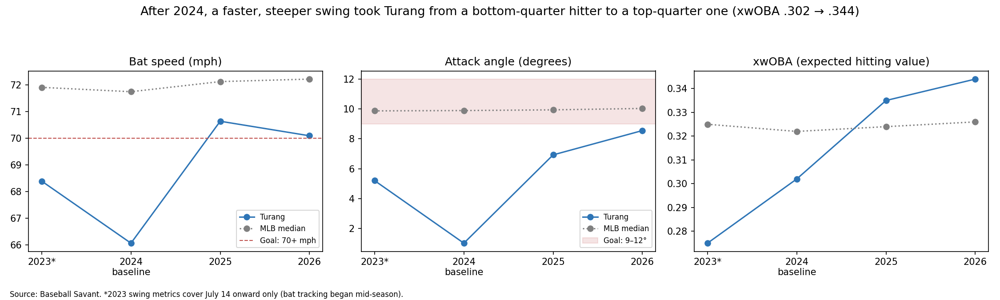
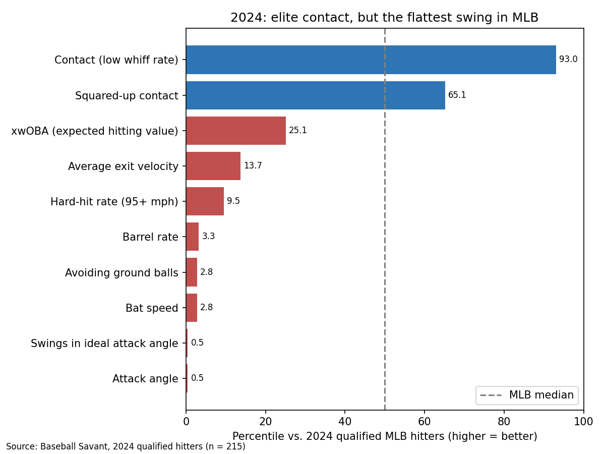
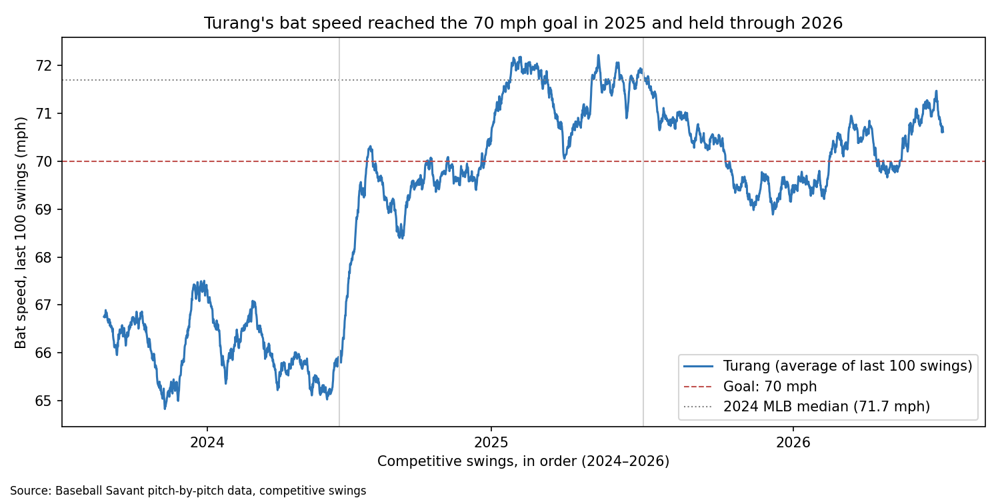

# Brice Turang: Hitter Development Plan

**A player development plan built only from 2024 data, then tested against what actually happened in 2025 and 2026.**



---

## TL;DR

| | |
|---|---|
| **The question** | After the 2024 season, what was the #1 thing Brice Turang needed to fix in his swing, and how would we know it worked? |
| **The answer** | **Bat speed.** Across 215 qualified MLB hitters, it had the strongest link to damage of any swing metric (0.73 with barrel rate). Turang swung 66.1 mph, near the bottom of the league. |
| **The result** | His bat speed jumped to 70.6 mph in 2025 and held. His barrel rate more than tripled (2.4% → 7.9%), and his expected hitting value (xwOBA) went from the league's bottom quarter to its top quarter (.302 → .344). **3 of 4 goals met in both seasons.** |

---

## Why this project

In baseball, fixing one thing in a hitter's swing can change his career. In 2024, Turang was one of the best contact hitters in MLB: he missed on only 13.8% of his swings. But his swing was the slowest and flattest in the league, so all that contact turned into ground balls instead of damage.

I wanted to answer a question every player development (PD) department faces each off-season: **where does this player stand right now, and what is the one thing that will make him better next year?**

The twist: I built the plan using **only data available after 2024**, the way a PD analyst would have that winter. Then I opened 2025 and 2026 and scored the plan against reality. Most portfolio projects make a recommendation. This one checks whether the recommendation was right.

### Beyond baseball

The same method works anywhere decisions are made with data:

1. **Measure** where you stand, with numbers you can trust.
2. **Compare** against a benchmark, so the numbers mean something.
3. **Find the one gap** most tied to the outcome you care about.
4. **Set a measurable goal** before acting.
5. **Test it** against what actually happens.

Whether it's a swing or a business, the hardest part isn't finding problems. It's choosing the one that matters most.

---

## Approach

The full analysis is in [`notebooks/turang_idp.ipynb`](notebooks/turang_idp.ipynb), in 10 steps.

| Step | Question | What I did |
|---|---|---|
| 1–2 | Can I trust the data? | Loaded 9,962 pitches and 20 league leaderboards (2023–2026). Removed bunts and non-competitive swings, then rebuilt Savant's bat speed numbers **within 0.2 mph**. |
| 3–5 | Where does he rank? | Built league benchmarks (median and percentiles) and ranked Turang on 12 metrics. He was **last of 215** on attack angle and in the 3rd percentile on bat speed, but in the **93rd** on contact. |
| 6 | What is the #1 fix? | Compared each swing metric with damage across the league. Bat speed won clearly: **0.73** with barrels and **0.49** with xwOBA, vs. 0.36 and −0.01 for attack angle. |
| 7–8 | What's the plan? | Set four measurable goals from the benchmarks and wrote a three-phase drill plan (off-season, spring, in-season). |
| 9–10 | Did it work? | Built a season table, rolling 100-swing charts and a goal scorecard for 2025–2026. |



---

## Findings

### The goal scorecard

| Goal | 2024 | Target | 2025 | 2026 | Result |
|---|---|---|---|---|---|
| Bat speed (mph) | 66.1 | 70+ | 70.6 | 70.1 | ✅ Met both years |
| Attack angle (°) | 1.0 | 9–12 | 6.9 | 8.6 | ❌ Missed, but rising every year |
| Barrel rate (%) | 2.4 | 5+ | 7.9 | 7.7 | ✅ Met both years |
| Whiff rate (guardrail) | 13.8% | under 23% | 18.9% | 21.4% | ✅ Held, but close to the line |

### What the data shows

- **The change happened all at once.** His bat speed jumped right at the start of 2025, the signature of off-season work rather than a slow in-season build.
- **Speed came first, then the path.** His attack angle climbed gradually through 2025 and reached the 9–12° range only late in 2026.
- **He paid for it in contact.** His whiff rate rose from 13.8% to 21.4%, the trade-off the plan's guardrail was built to watch.
- **The trade was worth it.** He went from the league's 25th percentile in xwOBA (.302) to above the 75th (.344).
- **He didn't need an average swing to become an above-average hitter.** In 2026, his bat speed and attack angle were still below the league median, yet his xwOBA was well above it. A good-enough swing, on top of elite contact, was enough.



---

## Limitations

- **I don't know what the Brewers actually did.** The data shows his swing changed, not which drills caused it. My plan pointed in the right direction; that doesn't mean my drills are what worked.
- **Written in hindsight.** Every decision used only 2024 data, but I knew 2025 and 2026 had already happened. A real-time plan is the true test.
- **2024 was his low point.** In the second half of 2023 he already swung 68.4 mph, so part of the jump was a return to his earlier level.
- **Correlation isn't causation.** Faster bats go with more barrels across hitters; that doesn't prove adding speed causes barrels for every hitter.
- **Some results were luck.** His actual wOBA ran ahead of his expected wOBA in both seasons, so I judge results on xwOBA.

---

## Skills shown

- **Data cleaning and validation:** removed bunts and non-competitive swings, then checked my numbers against a trusted source (within 0.2 mph of Baseball Savant).
- **Combining data sources:** merged five league leaderboards across four seasons into one table, fixing mismatched ID columns along the way.
- **Benchmarking:** league medians and percentiles to turn raw numbers into gaps and targets.
- **Statistical reasoning:** percentile ranks, correlation, sample size and standard error, rolling averages, and knowing the limits of each.
- **Data visualization:** takeaway titles, percentile profiles, scatter plots, rolling trends and a multi-panel hero chart (Matplotlib).
- **Turning data into decisions:** one priority, measurable goals, a guardrail, and a drill plan a coach can run.
- **Communication:** the same finding written for a player, a hitting coach and a PD director, in English and Spanish.

**Tools:** Python, pandas, NumPy, Matplotlib, Jupyter, Baseball Savant (Statcast)

---

## How to run it

1. **Requirements:** Python 3.10+ with pandas, NumPy and Matplotlib.

   ```bash
   pip install pandas numpy matplotlib jupyter
   ```

2. **Clone the repository:**

   ```bash
   git clone https://github.com/OmarMorillo/turang-hitter-development-plan.git
   cd turang-hitter-development-plan
   ```

3. **Open the notebook and run all cells:** `notebooks/turang_idp.ipynb`.
   The raw data is in `data/raw/` (sources and download dates in [`data/raw/SOURCES.md`](data/raw/SOURCES.md)). The notebook writes cleaned files to `data/clean/` and charts to `outputs/charts/`.

## Repository structure

```text
turang-hitter-development-plan/
├── README.md
├── data_dictionary.md        # every column used: meaning, units, source
├── data/
│   ├── raw/                  # Baseball Savant downloads, unchanged
│   └── clean/                # written by the notebook
├── notebooks/
│   └── turang_idp.ipynb      # the full analysis, Steps 1–10
├── outputs/
│   └── charts/               # every chart in the notebook
└── deliverables/             # one-pager (EN/ES) and deck (coming soon)
```

## Deliverables

| Deliverable | Audience | Status |
|---|---|---|
| Analysis notebook | Analysts, PD staff | ✅ [View](notebooks/turang_idp.ipynb) |
| One-pager (English) | Player, hitting coach | Coming soon |
| One-pager (Spanish) | Player, hitting coach | Coming soon |
| Deck (6–7 slides) | PD director | Coming soon |

**Data:** Baseball Savant, MLB Advanced Media (baseballsavant.mlb.com). Regular season, 2023–2026. Bat tracking began July 14, 2023, so 2023 swing metrics cover the second half only.

---

## About me

**Omar Morillo Aldana**

I've played baseball my whole life, formed in Venezuelan baseball and then as a four-year college player (NAIA and NCAA Division II, 1st Team All-Conference and All-Region honors). For most of that time, I knew the game from the inside but had never looked at the data behind it.

Now I'm learning that side. With public data like Baseball Savant, and the training science from places like Driveline, I can see a bigger and clearer picture of what a hitter needs, and connect it to what I see as a coach. I'm Driveline-certified in hitting (Foundations of Hitting and Hitting Coach), and I've completed coursework in Blast Motion bat sensors, Bertec force plates and VALD ForceDecks. I coached as an intern with Point Park University Baseball in 2026, and I'm pursuing an M.S. in Information Systems at Point Park University.

My goal: help players and coaches make better decisions by combining what the numbers say with how the swing actually works.

- **GitHub:** [OmarMorillo](https://github.com/OmarMorillo)
- **LinkedIn:** [Omar Morillo](https://www.linkedin.com/in/omar-morillo-203a9124a/)
- **Email:** Morilloaldanaomar@gmail.com

---

## Resumen en español

**Brice Turang: plan de desarrollo de un bateador**

**La pregunta:** después de la temporada 2024, ¿qué era lo más importante que Brice Turang tenía que mejorar en su swing, y cómo sabríamos si funcionó?

**La respuesta:** **la velocidad del bate.** Entre los 215 bateadores calificados de MLB, fue la métrica del swing más relacionada con el daño (0.73 con el porcentaje de barrels). Turang bateaba a 66.1 mph, casi en el último lugar de la liga.

**El resultado:** su velocidad del bate subió a 70.6 mph en 2025 y se mantuvo. Su porcentaje de barrels se triplicó (2.4% → 7.9%), y su valor ofensivo esperado (xwOBA) pasó del cuarto más bajo de la liga al cuarto más alto (.302 → .344). **Cumplió 3 de 4 metas en ambas temporadas.**

**Lo especial del proyecto:** armé el plan usando **solo los datos disponibles después de 2024**, como lo haría un analista de desarrollo de jugadores ese invierno. Después comparé el plan con lo que realmente pasó en 2025 y 2026.

**Lo que muestran los datos:**
- **El cambio llegó de golpe.** Su velocidad del bate subió justo al empezar 2025, señal de trabajo hecho en la pretemporada.
- **Primero la velocidad, después el ángulo.** Su ángulo de ataque subió poco a poco durante 2025 y llegó al rango de 9–12° a finales de 2026.
- **Pagó un precio en contacto.** Su porcentaje de swings fallados subió de 13.8% a 21.4%, pero se mantuvo por debajo del límite de 23% que puso el plan.
- **Valió la pena.** Pasó de ser un bateador del cuarto más bajo de la liga a uno del cuarto más alto en valor esperado.

**Sobre mí:** soy Omar Morillo Aldana, formado en el béisbol venezolano y exjugador universitario (NAIA y NCAA División II). Estoy certificado por Driveline en bateo y estudio una maestría en Sistemas de Información en Point Park University. Mi meta es ayudar a jugadores y entrenadores a tomar mejores decisiones, combinando lo que dicen los números con cómo funciona el swing de verdad.
